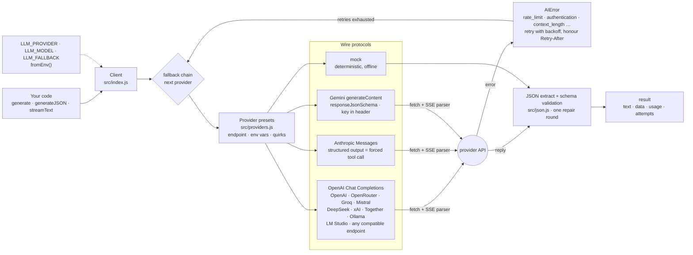

# universal-llm-client

**Bring your own AI.** One small, zero-dependency client for the major model providers, with fallback chains, retries, structured JSON output, streaming and an offline mock. Your users or your ops team choose the provider; your code stays the same.

English | [Türkçe](README.tr.md)

[](https://github.com/Tngc93/universal-llm-client/actions/workflows/ci.yml)
[](LICENSE)


<picture>
  <source media="(prefers-color-scheme: dark)" srcset="docs/assets/how-it-works-dark.svg">
  
</picture>

```js
import { createAI } from 'universal-llm-client';

const ai = createAI({
  provider: 'anthropic',
  model: 'your-claude-model-id',
  fallback: [{ provider: 'openai', model: 'your-gpt-model-id' }, 'ollama:llama3.2', 'mock'],
});

const { text } = await ai.generate({ prompt: 'Summarise this ticket in one line: …' });

const { data } = await ai.generateJSON({
  prompt: 'Extract the order from: "2 × X15 laptop, ship to Ankara"',
  schema: {
    type: 'object',
    properties: { product: { type: 'string' }, quantity: { type: 'integer', minimum: 1 }, city: { type: 'string' } },
    required: ['product', 'quantity', 'city'],
  },
});

for await (const chunk of ai.streamText({ prompt: 'Write a haiku about retries.' })) process.stdout.write(chunk);
```

## Why

Every AI feature ends up rewriting the same layer: three request formats, three streaming formats, ten ways to say "rate limited", a retry loop, a fallback when the provider is down, a fake provider for tests and demos, and a rule that the API key never reaches a log line. universal-llm-client is that layer: about 1,200 lines of plain JavaScript with no dependencies.

- **One API, 12 providers.** OpenAI, Anthropic, Google Gemini, OpenRouter, Groq, Mistral, DeepSeek, xAI, Together, Ollama, LM Studio and any OpenAI-compatible endpoint (vLLM, LiteLLM, gateways), plus `mock`.
- **Fallback chains.** `anthropic → openai → ollama → mock`. A provider that is down, rate-limited, out of credit or simply not configured is skipped, and `result.attempts` tells you what happened. Streams fall back only before the first token, never mid-answer.
- **Structured output that holds.** `generateJSON` uses each provider's native mechanism (JSON Schema response format, a forced tool call on Claude, `responseJsonSchema` on Gemini), validates the result against your schema, and if it does not match, shows the model the errors and asks once more. Plug in zod or any validator with `validate`.
- **Errors you can branch on.** `rate_limit`, `insufficient_credits`, `context_length`, `content_filter`, `authentication`, … the same code whichever provider failed. Retries with backoff honour `Retry-After`.
- **Safe with keys.** Keys are never put in URLs, never appear in error messages, and cannot leak through `JSON.stringify(client)` or `console.log(client)`. Sending a key over plain HTTP to a remote host, or from a browser, is refused unless you opt in.
- **Offline mock.** Deterministic replies, schema-valid JSON generated from your schema, simulated failures. Tests, CI and demos run without keys or network.
- **No stale defaults.** There are no built-in model names, because model ids change every few months. You choose the model, in code or in an env var.

## How it works



## Install

```bash
npm install github:Tngc93/universal-llm-client
```

Node 18.17+, ESM only, TypeScript types included. It uses only `fetch`, `ReadableStream` and `AbortController`, so Bun, Deno and edge runtimes should work too, but CI tests Node only for now.

## Configure from the environment

`fromEnv()` lets whoever deploys your app pick the provider:

```bash
LLM_PROVIDER=anthropic          # default: mock
LLM_MODEL=your-claude-model-id
ANTHROPIC_API_KEY=...
LLM_FALLBACK=openai:your-gpt-model-id,ollama:llama3.2,mock
LLM_TIMEOUT_MS=30000            # optional
LLM_MAX_RETRIES=2               # optional
```

```js
import { fromEnv } from 'universal-llm-client';
const ai = fromEnv();
```

With no variables set, `fromEnv()` uses the mock provider, so a fresh checkout runs without spending anything.

| Provider | `provider` | Key env var | Model env var | Default base URL |
| --- | --- | --- | --- | --- |
| OpenAI | `openai` | `OPENAI_API_KEY` | `OPENAI_MODEL` | `https://api.openai.com/v1` |
| Anthropic | `anthropic` | `ANTHROPIC_API_KEY` | `ANTHROPIC_MODEL` | `https://api.anthropic.com` |
| Google Gemini | `gemini` | `GEMINI_API_KEY` or `GOOGLE_API_KEY` | `GEMINI_MODEL` | `https://generativelanguage.googleapis.com/v1beta` |
| OpenRouter | `openrouter` | `OPENROUTER_API_KEY` | `OPENROUTER_MODEL` | `https://openrouter.ai/api/v1` |
| Groq | `groq` | `GROQ_API_KEY` | `GROQ_MODEL` | `https://api.groq.com/openai/v1` |
| Mistral | `mistral` | `MISTRAL_API_KEY` | `MISTRAL_MODEL` | `https://api.mistral.ai/v1` |
| DeepSeek | `deepseek` | `DEEPSEEK_API_KEY` | `DEEPSEEK_MODEL` | `https://api.deepseek.com/v1` |
| xAI | `xai` | `XAI_API_KEY` | `XAI_MODEL` | `https://api.x.ai/v1` |
| Together | `together` | `TOGETHER_API_KEY` | `TOGETHER_MODEL` | `https://api.together.xyz/v1` |
| Ollama | `ollama` | none | `OLLAMA_MODEL` | `http://localhost:11434/v1` |
| LM Studio | `lmstudio` | none | `LMSTUDIO_MODEL` | `http://localhost:1234/v1` |
| Any OpenAI-compatible | `openai-compatible` | `LLM_API_KEY` | `LLM_MODEL` | `LLM_BASE_URL` |
| Offline mock | `mock` | none | none | none |

Every provider also reads `<NAME>_BASE_URL` (for example `OPENAI_BASE_URL`), so proxies and gateways need no code change.

## API

### `createAI(options)` → client

| Option | Default | |
| --- | --- | --- |
| `provider` | required | One of the ids above. |
| `model` | env var | Required except for `mock`. |
| `apiKey`, `baseUrl` | env vars | |
| `fallback` | `[]` | `ProviderConfig` objects or `"provider:model"` strings, tried in order. |
| `fallbackOn(err)` | all but `aborted` | Return `false` to stop the chain for an error. |
| `timeoutMs` | `60000` | Per attempt. For streams it covers connecting, not the whole generation. |
| `maxRetries` | `2` | Retries on `rate_limit`, `overloaded`, `unavailable`, `timeout`, `network`. |
| `headers` | `{}` | Extra headers, e.g. OpenRouter's `HTTP-Referer`. |
| `jsonMode` | per provider | Override for OpenAI-compatible servers: `json_schema`, `json_object` or `prompt`. |
| `onRetry`, `onFallback` | | Hooks for logging and metrics. |
| `fetch` | `globalThis.fetch` | Inject your own (proxies, tests). |
| `mock` | | `{ reply, fail, delayMs }` for the mock provider. |
| `allowInsecureHttp`, `allowBrowser` | `false` | Explicit opt-ins, see Security. |

### `client.generate(options)` → `{ text, finishReason, usage, provider, model, attempts }`

`prompt` or `messages` (`user` / `assistant` / `system`), plus `system`, `maxTokens` (default 1024), `temperature` (sent only when set), `stop`, `signal` and `providerOptions` (extra request-body fields passed through as-is).

### `client.generateJSON({ ...options, schema, name?, validate?, repairAttempts?, strict? })` → `{ data, repairs, … }`

Throws `AIError('invalid_response')` with `err.issues` if the output still does not match after `repairAttempts` (default 1).

### `client.stream(options)` / `client.streamText(options)`

`stream` yields `{ type: 'text', text }` events and a final `{ type: 'done', text, usage, finishReason, provider, model, attempts }`. `streamText` yields only the strings.

### `client.info()`

The provider chain with `hasApiKey` flags and no secrets. Safe to log.

### Errors

Every failure is an `AIError` with `code`, `provider`, `status`, `retryable`, `retryAfterMs` and `attempts`:

| `code` | Typical cause | Retried |
| --- | --- | --- |
| `configuration` | Missing key, model or base URL; unsafe URL | no (falls back) |
| `authentication` / `permission` | Wrong key, no access to the model | no |
| `insufficient_credits` | Billing or quota exhausted | no |
| `rate_limit` / `overloaded` | 429 / 529 | yes |
| `unavailable` / `timeout` / `network` | 5xx, slow or unreachable provider | yes |
| `context_length` | Prompt too long for the model | no |
| `content_filter` | Refusal or safety block | no |
| `invalid_request` / `not_found` | Bad parameter, unknown model | no |
| `invalid_response` | Unparseable output, schema mismatch | no |
| `aborted` | Your `signal` fired | no, and no fallback |

## Security

- **Keys stay out of URLs.** Gemini receives its key in the `x-goog-api-key` header, not `?key=`. Base URLs that contain credentials, a query string or a fragment are rejected.
- **Keys stay out of logs.** Error messages are scrubbed of anything that looks like a key, and the key you passed is removed explicitly. The client object hides keys from `JSON.stringify` and `util.inspect`.
- **No plaintext keys.** An API key is never sent over `http://` to a non-loopback host unless `allowInsecureHttp: true`.
- **No keys in browsers by accident.** Calling a cloud provider with a key from browser code throws unless `allowBrowser: true`. Use that only when each user supplies their own key; otherwise call the model from your server.

## Testing your app

Use the mock provider. It needs no key or network:

```js
const ai = createAI({ provider: 'mock', mock: { reply: (req) => (req.json ? { ok: true } : 'canned answer') } });
const flaky = createAI({ provider: 'mock', mock: { fail: 'rate_limit' }, fallback: ['mock'] });
```

The library's own tests run every provider protocol against a local fake server, including chunked SSE streams, error bodies, retries, timeouts and aborts. `npm test` needs no network.

## Limits of v0.1

- Text in and text out. No images, audio, tool use (beyond structured output) or embeddings yet.
- Every request and response format follows the providers' public API docs and is tested against a fake server. Behaviour against live APIs has not been verified for every provider and model. Please open an issue if one misbehaves.
- No token counting or cost estimates.

## Origin

universal-llm-client was extracted from the provider layer of [Atlas AI](https://github.com/Tngc93/Atlas-AI), where the same app had to run on a mock demo, a user's own Gemini key, a local Ollama model or a server-side Claude/OpenAI key.

## License

[MIT](LICENSE) © Berk Arcak
