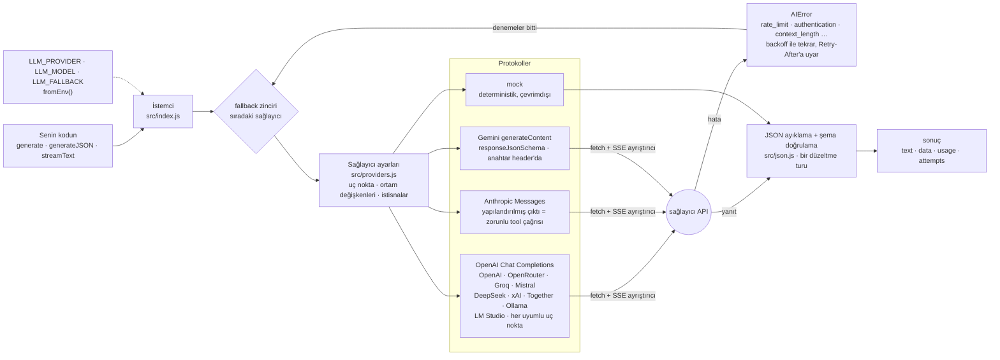

# universal-llm-client

**Kendi yapay zekânı getir.** Büyük model sağlayıcıları için küçük ve bağımlılıksız bir istemci. Fallback zincirleri, yeniden denemeler, yapılandırılmış JSON çıktısı, streaming ve çevrimdışı bir mock sağlayıcı içerir. Sağlayıcıyı kullanıcıların ya da ekibin seçer; kodun değişmez.

[English](README.md) | Türkçe

<picture>
  <source media="(prefers-color-scheme: dark)" srcset="docs/assets/how-it-works-dark.svg">
  
</picture>

```js
import { createAI } from 'universal-llm-client';

const ai = createAI({
  provider: 'anthropic',
  model: 'claude-model-kimliğin',
  fallback: [{ provider: 'openai', model: 'gpt-model-kimliğin' }, 'ollama:llama3.2', 'mock'],
});

const { text } = await ai.generate({ prompt: 'Bu talebi tek satırda özetle: …' });

const { data } = await ai.generateJSON({
  prompt: '"2 adet X15 laptop, Ankara\'ya gönder" metninden siparişi çıkar',
  schema: {
    type: 'object',
    properties: { urun: { type: 'string' }, adet: { type: 'integer', minimum: 1 }, sehir: { type: 'string' } },
    required: ['urun', 'adet', 'sehir'],
  },
});
```

## Neden

Her AI özelliği aynı katmanı yeniden yazmak zorunda kalıyor: üç farklı istek formatı, üç farklı streaming formatı, "rate limit"in on farklı söylenişi, bir retry döngüsü, sağlayıcı çöktüğünde devreye girecek bir yedek, testler ve demolar için sahte bir sağlayıcı ve API anahtarının hiçbir log satırına düşmemesi kuralı. universal-llm-client bu katmanın kendisi: yaklaşık 1.200 satır, bağımlılık yok.

- **Tek API, 12 sağlayıcı.** OpenAI, Anthropic, Google Gemini, OpenRouter, Groq, Mistral, DeepSeek, xAI, Together, Ollama, LM Studio, OpenAI uyumlu her uç nokta ve `mock`.
- **Fallback zinciri.** Örneğin `anthropic → openai → ollama → mock`. Çökmüş, rate limit'e takılmış, kredisi bitmiş ya da hiç yapılandırılmamış bir sağlayıcı atlanır. Ne olduğu `result.attempts` alanında görünür. Streaming'de yedeğe yalnızca ilk token'dan önce geçilir; cevabın ortasında model değişmez.
- **Güvenilir yapılandırılmış çıktı.** `generateJSON` her sağlayıcının kendi yöntemini kullanır, sonucu şemaya göre doğrular ve uymazsa hataları modele gösterip bir kez daha sorar.
- **Üzerinde dallanılabilen hata kodları.** `rate_limit`, `insufficient_credits`, `context_length`, `content_filter` gibi kodlar, hangi sağlayıcı hata verirse versin aynıdır.
- **Anahtarlar güvende.** Anahtarlar URL'ye konmaz, hata mesajlarında görünmez, `console.log(client)` ile sızmaz. Uzak bir sunucuya düz HTTP üzerinden ya da tarayıcıdan anahtar göndermek, açıkça izin verilmedikçe reddedilir.
- **Çevrimdışı mock.** Deterministik cevaplar, şemadan üretilen geçerli JSON ve simüle edilmiş hatalar. Testler, CI ve demolar anahtarsız ve ağsız çalışır.
- **Eskiyen varsayılan yok.** Model kimlikleri birkaç ayda bir değiştiği için yerleşik model adı yoktur; modeli sen seçersin.

## Nasıl çalışır



## Kurulum

```bash
npm install github:Tngc93/universal-llm-client
```

Node 18.17+, yalnızca ESM, TypeScript tipleri dahil.

## Ortam değişkenleriyle yapılandırma

```bash
LLM_PROVIDER=anthropic          # varsayılan: mock
LLM_MODEL=claude-model-kimliğin
ANTHROPIC_API_KEY=...
LLM_FALLBACK=openai:gpt-model-kimliğin,ollama:llama3.2,mock
```

```js
import { fromEnv } from 'universal-llm-client';
const ai = fromEnv();
```

Hiçbir değişken yoksa `fromEnv()` mock sağlayıcıyı kullanır; yeni klonlanmış bir proje hiç para harcamadan çalışır.

Sağlayıcı tablosu, API ayrıntıları, hata kodları ve güvenlik kuralları için İngilizce [README](README.md)'ye bakın.

## v0.1 sınırları

- Yalnızca metin girdisi ve çıktısı var; görsel, ses, tool use ve embedding henüz yok.
- İstek ve yanıt formatları sağlayıcıların açık API dokümanlarına göre yazıldı ve sahte bir sunucuya karşı test edildi. Her sağlayıcı ve model için canlı API'ye karşı henüz doğrulanmadı.

## Köken

universal-llm-client, [Atlas AI](https://github.com/Tngc93/Atlas-AI)'ın sağlayıcı katmanından çıkarıldı.

## Lisans

[MIT](LICENSE) © Berk Arcak
